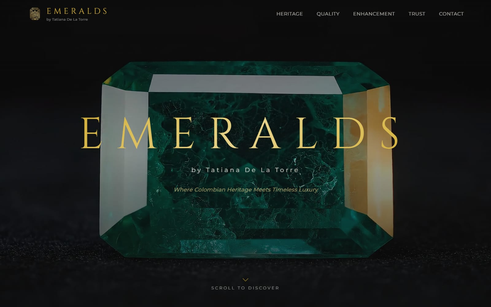
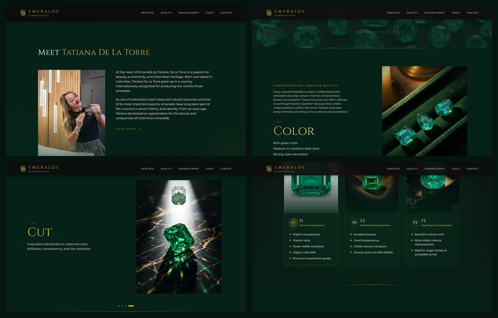
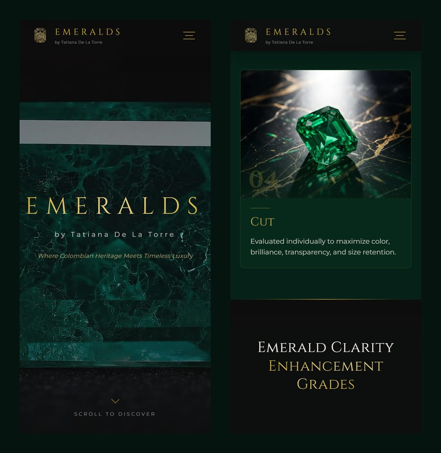

<div align="center">



# Emeralds by Tatiana De La Torre

**Colombian emeralds presented the way a museum would present them — dark velvet, gold type, and a scroll that teaches you how to judge a stone before it asks you to buy one.**

<br/>


[Overview](#overview) · [The journey](#the-journey) · [Highlights](#highlights) · [Screenshots](#screenshots) · [Architecture](#architecture) · [Run it](#run-it)

</div>

---

## Overview

The official site of **Emeralds by Tatiana De La Torre**, a Colombian gemstone dealer who selects emeralds personally from the Muzo region. Fine emeralds are bought on trust, so the brief was not to show a catalogue: it was to make a first-time buyer feel *educated and safe* — to understand colour, transparency, cut and treatment grades — and to meet the person behind every stone.

The design borrows from the jeweller's own tools: deep emerald velvet (`#062117` → `#0A3B24`), gold leaf type in **Cinzel** over **Montserrat**, thin gold dividers, and photography lit like a vitrine.

## The journey

| # | Section | What happens |
|---|---|---|
| 1 | **Hero** | The gold wordmark resolves over a cut emerald, letter-spaced like an engraving. |
| 2 | **Meet Tatiana** | Her story, told beside her portrait, so the buyer knows who is choosing the stones. |
| 3 | **Understanding quality** | The section pins and becomes a **horizontal scroll**: Color → Clarity → Transparency → Cut, one panel per scroll, with the exact traits Tatiana looks for. |
| 4 | **Emerald colours & origin** | The range of greens, and where in Colombia they come from. |
| 5 | **Enhancement grades** | F1 · F2 · F3 explained side by side, from minor to significant enhancement. |
| 6 | **Oil treatment** | What clarity enhancement is, said plainly — "transparency regarding the treatment status of every gemstone". |
| 7 | **Trust · Commitment · Promise** | GIA certificates, Muzo sourcing and a personal message from Tatiana. |

## Highlights

| | |
|---|---|
| 🎞️ **Scroll-choreographed** | GSAP ScrollTrigger runs through all ten sections — scrubbed parallax, staggered reveals and one pinned horizontal gallery whose length is computed from the viewport, so it never leaves blank space after the last panel. |
| 🧈 **Smooth, but native underneath** | Lenis smooths the wheel while ScrollTrigger reads the real scroll position, so anchors, keyboard scrolling and accessibility tools keep working. |
| 🔎 **Structured for search** | A connected JSON-LD graph — `JewelryStore`, `Organization`, `Person`, `Product` with an `OfferCatalog`, `WebSite` and a 6-question `FAQPage` — plus a generated `sitemap.xml` and `robots.txt`. |
| 🖼️ **Luxury that still loads fast** | Next.js App Router with `next/image`; every photograph is shipped as WebP (22 optimised assets), and fonts come through `next/font`, which self-hosts them at build time so text never reflows. |
| 📱 **Re-composed for phones** | The pinned horizontal gallery switches to a layout built for touch screens instead of being shrunk. |

## Screenshots

<div align="center">
  
  <br/><sub><b>Desktop</b> — Meet Tatiana, the quality gallery (Color and Cut) and the enhancement grades.</sub>
  <br/><br/>
  
  <br/><sub><b>Mobile</b></sub>
</div>

## Architecture

```
src/
├── app/
│   ├── layout.tsx         metadata, fonts, providers
│   ├── page.tsx           section order
│   ├── sitemap.ts · robots.ts
├── components/
│   ├── sections/          Hero, Heritage, Origin, QualitySlider, EmeraldColors,
│   │                      EnhancementGrades, OilTreatment, Trust, Commitment, Promise
│   ├── providers/         GSAPProvider (plugin registration) · SmoothScroll (Lenis)
│   ├── seo/JsonLd.tsx     the structured-data graph
│   └── ui/                Navbar, Footer, GoldDivider
└── lib/fonts.ts           Cinzel + Montserrat via next/font
public/assets/media/       photography (WebP)
```

| Token | Value |
|---|---|
| Emerald dark / deep / medium | `#062117` · `#0A3B24` · `#116B3E` |
| Gold / light / muted | `#D4AF37` · `#E8D48B` · `#C4A44A` |

## Run it

```bash
npm install
npm run dev        # http://localhost:3000
```

Production:

```bash
npm run build
npm run start      # honours $PORT, binds 0.0.0.0 — ready for Railway or any Node host
```

## License

© 2026 Devleck (Aleck Martinez). **All rights reserved.** The code is published as a portfolio case study: you may read it and run it locally to evaluate it, but you may not copy, redistribute or use it in another product without written permission. Brand names, logos, photographs and texts belong to their respective owners. See [LICENSE](LICENSE) · Permissions: contact@devleck.com

---

<div align="center">
<sub>Designed and engineered by <a href="https://www.devleck.com">Devleck</a> — Aleck Martinez.</sub>
</div>
